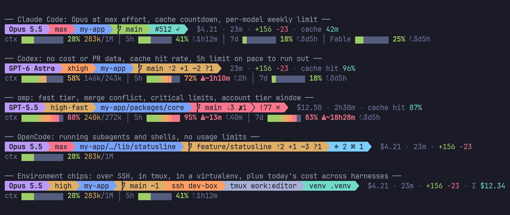
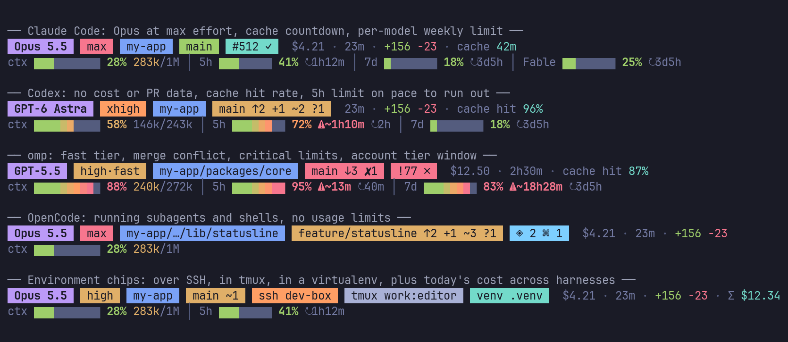
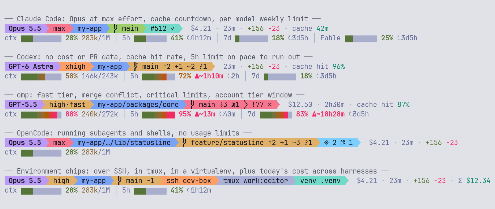

# oh-my-statusline

[](https://github.com/m16khb-org/oh-my-statusline/actions/workflows/test.yml)
[](LICENSE)
[](https://bun.sh)

One two-row powerline status line for four AI coding agents: [Claude Code](https://code.claude.com/docs/en/statusline),
[Codex CLI](https://developers.openai.com/codex/cli), [omp](https://github.com/can1357/oh-my-pi) (oh-my-pi) and
[OpenCode](https://opencode.ai). Each agent feeds its own session data into one shared renderer, so the
chips, colors and layout look the same everywhere.



[한국어](README.ko.md) · [Install guide](INSTALL.md) · [Architecture](docs/architecture.md)

It replaces four separate projects (`claude-code-statusline`, `codex-statusline`, `omp-statusline`,
`opencode-statusline`) with one TypeScript + Bun codebase and zero runtime npm dependencies.
The installer takes over an old install for you; see [Migrating](#migrating-from-the-four-old-projects).

## The layout

**Row 1**: chips joined by powerline arrows, then session stats.

| Chip | Content | Color |
|---|---|---|
| Model | `Opus 5.5`, `GPT-5.5`, … | purple Opus, GPT and o-series, DeepSeek; cyan Sonnet, Kimi; teal Haiku, GLM; orange Fable, Qwen; blue Gemini; slate Grok; silver anything else |
| Effort | `max`, `xhigh`, `high`, `medium`, … plus `·fast` while the fast tier is on | red `max`, orange `xhigh`, yellow `high`, teal `medium`, slate anything else |
| Directory | repository name and the path below the checkout root (a deep path is elided to `…/parent/folder`), plus a linked worktree's name when it differs from the branch | blue |
| Git | branch, `⇡` ahead, `⇣` behind, `✘` conflicts, `+` staged, `~` modified, `?` untracked | green when clean, yellow when dirty, red on conflicts |
| PR / MR | `#512` (GitHub) or `!512` (GitLab) with `✓` approved, `✗` changes requested, `draft`; Cmd/Ctrl+click opens it | teal approved, red changes requested, cyan pending, slate draft |
| Running | `◈ 2` subagents, `⌘ 1` shells (where the harness has them) | cyan |
| Environment | `ssh <host>`, `tmux <session>:<window>`, `venv <name>`, `k8s <context>` | orange, silver, teal, purple |

After the chips come the session stats, each hidden when it has nothing to say: cost (hidden at zero),
duration (hidden under one minute), lines added and removed, the time left before the prompt cache
expires (`cache 42m`) or the last request's cache hit rate (`cache hit 87%`), and, when enabled,
today's cost across all four harnesses (`Σ $12.34`).

The line counts are the repository's staged and unstaged changes against `HEAD`
(`git diff HEAD --shortstat`; untracked files are not counted).

**Row 2**: gauges, each a bar graded cell by cell from green to red, the used share, and a reset
countdown.

- `ctx`: context window used with the token count (`283k/1M`); the count turns yellow past 200k tokens.
- `5h` / `7d`: plan usage limits with the time until each resets (`↻1h12m`).
- A tier-scoped weekly limit (`Fable`, for example) when the plan has one.
- `⚠~45m`: at the window's average pace so far, the limit runs out in about 45 minutes, before it resets.
- Percentages are green under 50%, yellow from 50%, orange from 65% and red from 80%.
- `ctx —` or `7d —` marks a window that exists but has no reading yet.





### Narrow terminals

Nothing is printed below 20 columns (OpenCode keeps its own `minimumWidth`, default 44). Above that, the
rows give up the least important parts first, in this order:

1. Row 1: the environment chips and `Σ` together, then cache, lines, duration, cost, PR, effort; then the
   branch is cut to 20 cells, the directory to the repository name, and finally the directory goes.
2. Row 2: the bars shrink first (ctx 10 → 8 → 6 → 0 cells, limits 8 → 6 → 4 → 0), then the token count,
   the reset countdowns and the tier-scoped windows go, and last the whole row.

```
 Opus 5.5   max   my-app   main   #512 ✓   $4.21 · 23m · +156 −23 · cache 42m   (120 columns)
ctx ▆▆▆▁▁▁▁▁▁▁ 28% 283k/1M │ 5h ▆▆▆▁▁▁▁▁ 41% ↻1h12m │ 7d ▆▁▁▁▁▁▁▁ 18% ↻3d5h │ Fable ▆▆▁▁▁▁▁▁ 25% ↻3d5h

 Opus 5.5   max   my-app   main   #512 ✓   $4.21 · 23m · +156 −23                    (70 columns)
ctx 28% 283k/1M │ 5h 41% ↻1h12m │ 7d 18% ↻3d5h │ Fable 25% ↻3d5h
```

(The arrows and branch icon are private-use glyphs and cannot be shown in this text; this is the
`plain` glyph set drawn without colors.)

## What each harness shows

Each harness draws what it knows and leaves out the rest; a value is never invented.

| Feature | Claude Code | Codex | omp | OpenCode |
|---|:-:|:-:|:-:|:-:|
| model, effort | ✓ | ✓ | ✓ | ✓ |
| directory, git, lines, duration | ✓ | ✓ | ✓ | ✓ |
| PR / MR (`gh` / `glab`) | ✓ | ✓ | ✓ | ✓ |
| session cost | ✓ | – | ✓ | ✓ |
| cache countdown / hit rate | countdown | hit rate | countdown, else hit rate | – |
| `ctx` gauge | ✓ | ✓ | ✓ | ✓ |
| `5h` / `7d` limits | ✓ | ✓ | ✓ | – |
| tier-scoped limits | ✓ | – | ✓ | – |
| subagents | panel | – | `◈` chip | `◈` and `⌘` chips |
| ssh / tmux / venv / k8s chips, `Σ` | ✓ | ✓ | ✓ | ✓ |

The reason for every `–`, the footnotes and the full table are in [docs/feature-matrix.md](docs/feature-matrix.md).
How the chips and ladder differ from the four originals is in [docs/parity.md](docs/parity.md).

## Quick start

Requirements: [Bun](https://bun.sh), macOS or Linux, and the agents you want to use. Codex also needs
`tmux`. `gh` or `glab` adds the PR/MR chip; `kubectl` adds the optional `k8s` chip.

```sh
git clone https://github.com/m16khb-org/oh-my-statusline.git
cd oh-my-statusline
./install.sh claude            # Claude Code
./install.sh claude codex omp opencode   # any combination; `all` is the same four
./install.sh                   # on a terminal: a checklist, with the harnesses found here marked
./install.sh all --dry-run     # print every step, write nothing
```

`./install.sh --plain` draws chips as separate badges without private-use glyphs, for fonts that are not
patched for powerline. Per-harness details, what each install writes where, and troubleshooting are in
[INSTALL.md](INSTALL.md).

The installer copies the runtime into each harness's own directory. To update, run `git pull && ./install.sh <harness>`
again.

## Configuration

Settings come from five layers; a later one wins:

1. built-in defaults
2. install choices: what `./install.sh` recorded (for example `--plain`)
3. the config file: top-level keys, then the `[harness.<id>]` table of the harness that is drawing
   (`claude`, `codex`, `omp`, `opencode`)
4. environment variables (`STATUSLINE_*`, `NO_COLOR`)
5. flags: only `bun run demo` takes command-line flags

The config file is `$XDG_CONFIG_HOME/oh-my-statusline/config.toml`, else
`~/.config/oh-my-statusline/config.toml`. It is optional. An invalid or unknown value is skipped, the
rest still applies, and a file that does not parse is ignored as a whole.

```toml
theme = "auto"          # "auto" | "dark" | "light"
glyphs = "powerline"    # "powerline" | "plain" | "ascii"
colors = "auto"         # "auto" | "truecolor" (or "24bit") | "256" | "none"
subagents = true        # Claude's agent panel, the ◈ chip on omp and OpenCode

[chips]
ssh = true
tmux = true
venv = true
k8s = false             # runs `kubectl config current-context` every 60 s

[stats]
chip = false            # today's cost across all harnesses, as `Σ $12.34`

[pr]
enabled = true          # PR/MR chip through gh / glab

# Per-harness overrides: the same keys, only for that harness.
[harness.codex]
glyphs = "plain"

[harness.omp.chips]
k8s = true
```

| Key | Values | Default | Environment variable |
|---|---|---|---|
| `theme` | `auto`, `dark`, `light` | `auto` (the harness's own light/dark mode) | `STATUSLINE_THEME` |
| `glyphs` | `powerline`, `plain`, `ascii` | `powerline` | `STATUSLINE_GLYPHS` |
| `colors` | `auto`, `truecolor` (`24bit`), `256`, `none` | `auto`: 24-bit when `COLORTERM` is `truecolor` or `24bit`, else 256 | `STATUSLINE_COLORS` |
| `subagents` | `true`, `false` | `true` | – |
| `chips.ssh` | `true`, `false` | `true` | – |
| `chips.tmux` | `true`, `false` | `true` | – |
| `chips.venv` | `true`, `false` | `true` | – |
| `chips.k8s` | `true`, `false` | `false` | – |
| `stats.chip` | `true`, `false` | `false` | – |
| `pr.enabled` | `true`, `false` | `true` | – |

`NO_COLOR` set to a non-empty value removes every color and bold in every harness, and nothing overrides it
(<https://no-color.org>). The three glyph
sets, color depths and the no-color mode are explained, with font advice, in
[docs/display-modes.md](docs/display-modes.md).

Where a harness differs:

- **Theme `auto`**: Claude Code and Codex read the macOS appearance (dark elsewhere), omp follows its
  active theme, OpenCode follows the TUI's light/dark mode.
- **Install choices**: `./install.sh --plain` is recorded where each harness can read it. For Codex (`install.json`),
  omp (`config.json`) and OpenCode (`cli.json` `options.glyphs`) it is the lowest layer, so `config.toml` and the
  environment override it. Claude Code's is a `STATUSLINE_GLYPHS=plain` prefix on the command, an ordinary
  environment variable that beats `config.toml`. Codex also records that tmux draws 24-bit color, which `colors`
  and `NO_COLOR` override.
- **OpenCode**: `glyphs` (including `ascii`) and `colors = "none"` / `NO_COLOR` apply as everywhere else. Any other
  color depth makes no difference, because the TUI draws RGB itself. The plugin `options` in `cli.json` hold the
  per-chip switches and layout; see [INSTALL.md](INSTALL.md#opencode).
- **omp**: `OMP_STATUSLINE_NATIVE=keep` leaves omp's built-in status bar untouched.
- **Codex**: `CODEX_STATUSLINE_DISABLE=1` runs the real Codex without the status line.

Set an environment variable where the harness reads it: in front of the command in Claude's
`settings.json`, in the shell that starts `codex-statusline`, `omp` or `opencode`.

## `stats`: cost and tokens across the harnesses

```sh
bun src/cli/stats.ts                          # every harness, all time
bun src/cli/stats.ts --since 7d               # the last 7 calendar days, today included
bun src/cli/stats.ts --harness codex --since today
bun src/cli/stats.ts --json                   # the same data as JSON
```

| Flag | Values | Default |
|---|---|---|
| `--harness` | `all`, `claude`, `codex`, `omp`, `opencode` | `all` |
| `--since` | `today`, `Nd` (for example `7d`, `30d`), `all` | `all` |
| `--json` | print JSON instead of the table | off |

It reads each harness's own session files read-only and prints, per harness and model, the sessions,
stored cost, tokens (input, output, cache read, cache write) and first and last activity. A harness
that stores no cost shows `–`, never `0`, and a `*` after a cost marks a harness where only some
sessions stored one. Day boundaries follow `$TZ`, else the system zone. The parsed results are cached in
`$XDG_CACHE_HOME/oh-my-statusline/stats-cache.json` (else `~/.cache/…`) so later runs only read what is
new. Where each number comes from is in [docs/stats-sources.md](docs/stats-sources.md).

## Demo

Preview every harness without a session:

```sh
bun run demo                                  # all cases at your terminal width
bun run demo --case omp --width 80
bun run demo --glyphs ascii --colors none --width 80
bun run demo --theme light --colors 256
```

Flags: `--case all|claude|codex|omp|opencode|chips|agents`, `--width N`, `--theme dark|light`,
`--glyphs powerline|plain|ascii`, `--colors 24|256|none`. The width defaults to `$COLUMNS`, then the
terminal, then 120. The screenshots above are rendered from this output with `tools/render_png.py`
(see [docs/architecture.md](docs/architecture.md#regenerating-the-screenshots)).

## Migrating from the four old projects

Run `./install.sh` for each harness you used. It finds the old install, keeps what you had before it,
carries over the glyph mode (and Codex's path and `codex` wrapper choice, OpenCode's options), and
removes the old directory, so a harness never ends up with two status lines. `--dry-run` prints the
plan first. The exact detection and carry-over rules per harness are in
[INSTALL.md](INSTALL.md#migrating-from-the-old-installs). Delete the four old repositories yourself once
you are happy; the installer never touches them.

## Uninstall

```sh
./uninstall.sh                  # a checklist of what is installed here
./uninstall.sh all              # or name the harnesses
./uninstall.sh claude --dry-run
```

It restores the `settings.json` entries (Claude) and `plugins` list (OpenCode) from before the install,
removes only the launchers and directories oh-my-statusline created, and keeps anything you changed
since. Your official Codex is never touched. Details in [INSTALL.md](INSTALL.md#uninstall).

## Development

```sh
bun install            # TypeScript and Bun types, the OpenCode plugin types; nothing is bundled at runtime
bun run typecheck      # tsc --noEmit
bun test               # unit, golden, install and architecture tests
bun run demo
```

The runtime has zero npm dependencies. The domain and application layers are pure and the boundary is
enforced by `test/architecture.test.ts`; see [docs/architecture.md](docs/architecture.md) for the layers,
the ports and where to add a chip. CI runs the type check and the tests on Ubuntu and macOS.

Other documents: [docs/glossary.md](docs/glossary.md), [docs/performance.md](docs/performance.md).

## License

[MIT](LICENSE).
