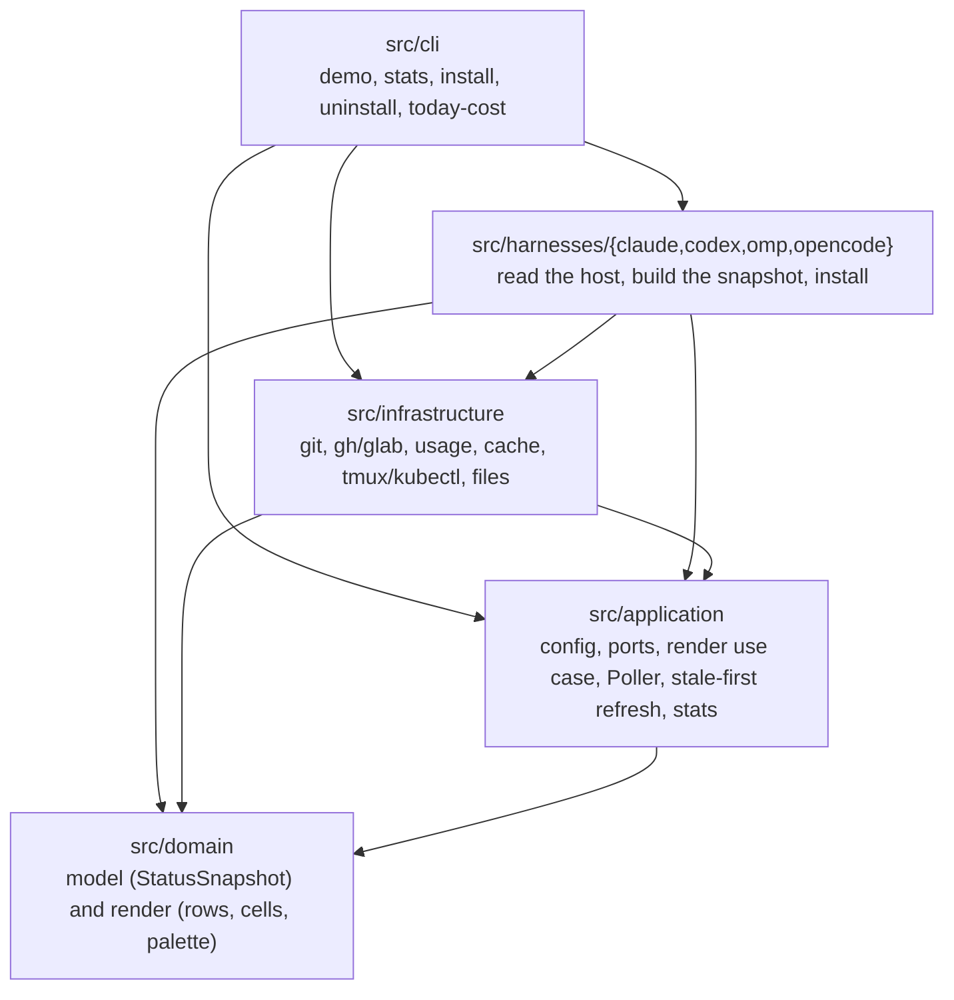
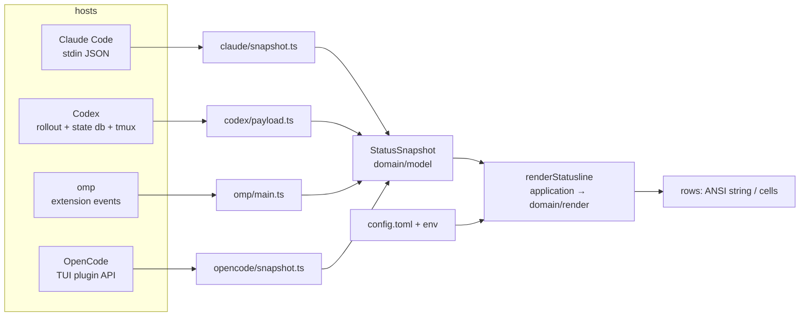

# Architecture

oh-my-statusline is one package with four layers. Each harness (Claude Code, Codex, omp, OpenCode) is an
adapter that turns its own session data into a harness-neutral `StatusSnapshot`; one renderer turns that
snapshot into two rows. Terms are defined in [glossary.md](glossary.md).

## Layers and dependency rules



An arrow means "may import". Nothing points back up.

| Layer | Contains | May import | Must not |
|---|---|---|---|
| `src/domain` | `model/`: the snapshot and its value types, with `toSnapshot` normalization. `render/`: palette, glyph sets, the width ladder, cells, the ANSI encoder, demo data | itself only | any package, `node:`/`bun:` module, host global (`Bun.`, `process.`, `Deno.`, `require(`), or an import cycle |
| `src/application` | `config.ts` (layer merging), `ports.ts`, `render-statusline.ts`, `poller.ts`, `refresh.ts`, `stats/` (parsers and aggregation) | itself and `src/domain` | `src/infrastructure`, `src/harnesses`, `src/cli`, any package, `node:`/`bun:` module, host global |
| `src/infrastructure` | adapters that do I/O: processes, files, network, the file cache, the installer kit | `src/application`, `src/domain` | `src/harnesses`, `src/cli` (a convention, see below) |
| `src/harnesses/<id>` | the only code that knows one host's API; builds a snapshot; its own installer | everything below it | another harness (a convention) |
| `src/cli` | command-line entry points | everything | – |

Two rules are enforced by a test, the other directions are conventions that currently hold:
`src/infrastructure` imports nothing from `src/harnesses` or `src/cli`, and no harness imports another.

The domain is pure on purpose: a render is a function of a snapshot and a `RenderContext`
(`width`, `nowMs`, `theme`, `glyphs`, `colors`, and an injected `measure` for the terminal width of a
string). The clock, the width function and every other outside input are passed in, so the 380,160-render
byte comparison against the old renderers in [parity.md](parity.md) is reproducible and the tests need no
terminal.

### The boundary tests

`test/architecture.test.ts` reads the source files (comments stripped) and fails on:

- **domain boundary**: any import specifier that is not a relative path inside `src/domain`
  (static, dynamic, `export … from`, `require`), a host global use, or an import cycle.
- **application boundary**: any non-relative specifier (packages, `node:`, `bun:`), a relative import that
  lands in `src/infrastructure`, `src/harnesses`, `src/cli` or outside `src/application` and `src/domain`, or a
  host global use.

Each describe block also checks the scanner itself against a temp directory of deliberately bad files
(7 violations for the domain, 11 for the application), so a scanner that stops matching cannot pass quietly.

## Ports and adapters

`src/application/ports.ts` is the list of what the application needs from the outside world. Every read
reports absent data as `null` instead of throwing, so a failing command only omits its segment.

| Port | Meaning | Adapter (`src/infrastructure/`) |
|---|---|---|
| `ClockPort` | `now()` in epoch ms | an inline `{ now: () => Date.now() }` in each entry point; tests pass a fake |
| `GitPort` | branch, ahead/behind, counts, checkout roots, working-tree lines vs HEAD | `GitAdapter` (`git.ts`) |
| `PrPort` | the open PR / MR of the branch | `PrAdapter` (`pr.ts`): `gh pr view`, or `glab mr view` for a remote URL containing `gitlab` |
| `UsagePort` | usage-limit windows from the provider | `ClaudeUsageAdapter` (`usage.ts`): the OAuth usage endpoint, token from `.credentials.json` or the macOS keychain |
| `AppearancePort` | the desktop's light/dark mode | `AppearanceAdapter` (`appearance.ts`): `defaults read -g AppleInterfaceStyle`, 30 s cache; `dark` where there is no `defaults` (not macOS), `light` when the key is missing (how macOS reports light mode) |
| `CachePort` | a key/value cache shared by short-lived processes, with a refresh lock | `FileCache` (`cache.ts`) |

Adapters that are not ports (nothing in the application layer calls them):

- `run` (`process.ts`) runs the commands whose output an adapter reads. Adapters take a `CommandRunner` so tests can
  inject failures and timeouts; OpenCode passes its own `nodeRunner` built on `node:child_process`, because its
  plugin may run under Node. Processes that outlive the caller (Claude's detached refresh helpers) or own a terminal
  (the Codex launcher, tmux) are spawned where they start.
- `EnvAdapter` (`env-chips.ts`): hostname, `tmux display-message`, `kubectl config current-context`.
- `Ambient` (`ambient.ts`): the background reads for long-lived processes, one `Poller` per source.
- `readConfigFile` / `defaultConfigPath` (`config-file.ts`): the TOML file. The application only merges what it is handed.
- `stats/` (`collect.ts`, `cache.ts`, `today.ts`, `today-process.ts`): the incremental session-file collector behind
  `bun src/cli/stats.ts` and the `Σ` chip.
- `install-kit.ts`: marker, checksums, backups, JSON edits, dry-run steps shared by the four installers.

## Why it stays lightweight

This is domain-driven in the narrow sense that matters here: a pure model with one ubiquitous language, a
render that depends on nothing, and adapters at the edge. It does not carry the usual machinery:

- **One package, no workspaces.** The installer copies `src/`, `package.json` and `LICENSE` into the harness's own
  directory (`<config>/oh-my-statusline`, an omp extension directory, …). Nothing is bundled and there is no
  `node_modules` at the destination, so the runtime has zero npm dependencies.
- **No DI container, no event bus.** A port is a plain interface and a collaborator is a function argument.
  Each entry point has one `defaultDeps()` that builds the real adapters, and the code that does the work takes
  a `Deps` object (`ClaudeDeps` in `harnesses/claude/main.ts`). That object is the seam the tests use to run the
  whole flow in-process.
- **Start-up cost is a feature.** Claude Code starts a new process for every refresh, so a render must load few
  modules and never wait on a slow command (see [performance.md](performance.md)).
- **Abstractions only where a second implementation exists** (the four harnesses, real versus fake I/O). Anything
  else is a plain function.
- **Development dependencies only for types.** `package.json` has no `dependencies`. Its `devDependencies` are
  `@types/bun` and `typescript`, plus `@opencode/plugin`, `@opentui/solid` and `solid-js`: the OpenCode plugin is
  TSX, and `tsc` needs the plugin API and the `@opentui/solid` JSX types to check it (`solid-js` is pinned to the
  exact version `@opentui/solid` peers on). At runtime OpenCode provides all three.

## Data flow per harness

Every harness ends the same way: build a snapshot with `toSnapshot(harness, raw)` (it never throws; malformed
parts become `null`, empty or zero), call `renderStatusline(snapshot, { config, width, nowMs, appearance, env,
measure })`, and show the rows. They differ in how the data arrives and how the rows leave.



| Harness | Trigger | Data | Output |
|---|---|---|---|
| Claude Code | Claude Code starts `bun …/claude/main.ts` on each refresh (and every 30 s, `refreshInterval`) | the session JSON on stdin; git, PR, per-model limits, tmux, k8s and today's cost from the `FileCache` (below) | two rows on stdout, width `$COLUMNS − 4`. With `--subagents`: one row per task for `subagentStatusLine` |
| Codex | `codex-statusline` runs Codex in a private tmux server and starts a collector beside it (`launcher.ts --collect`) | every 2 s: the pane title (the Codex thread id), width and directory from tmux; the thread row from `state_*.sqlite`; new lines of the rollout JSONL through `RolloutReader`; git; an `Ambient` for PR, env chips and `Σ` | two files, `row0` and `row1`, with the ANSI converted to tmux styles; tmux shows them with `#(cat …)` in a two-row status area |
| omp | omp loads the extension (`index.ts` shim → `harnesses/omp/main.ts`); events `session_start`, `message_end`, `agent_end`, `after_provider_response`, … plus a 1 s tick | what omp already knows (model, thinking level, context, cost, usage reports); git, PR, usage and `Ambient` reads through `Poller`s | `setWidget("oh-my-statusline", …)` below the prompt; in a terminal that speaks the Tern Surface Protocol the widget describes its rows as one `ansi` node instead of a `rows` fallback; omp's own status bar is trimmed in memory |
| OpenCode | OpenCode loads `<dir>/tui` (a `tui.tsx` shim) as a TUI plugin from `cli.json` | what the TUI knows (model variant, session cost and age, context, running subagents and shells); git through `GitWatcher`; `Ambient` for the rest | cells from `renderCells`, drawn by the plugin in the `prompt.footer` slot with 24-bit colors |

Details worth knowing:

- Claude Code is the only harness where each frame is a fresh process, so all of its slow data is cached on disk.
  The others keep state in memory and poll.
- Codex's status line lives outside Codex: the collector finds the session from the terminal title, because Codex
  exposes no extension API. A title that is not a Codex thread id selects nothing.
- OpenCode draws cells rather than ANSI, because the TUI styles text itself; `renderCells` is the same function
  `renderRows` wraps with `emit()`.
- A snapshot field a harness has no data for stays `null` or empty, so the matching chip is left out. The full
  table is [feature-matrix.md](feature-matrix.md).

## Caching

Two mechanisms, chosen by how long the process lives.

### FileCache, stale-first (short-lived processes: Claude Code)

`FileCache` implements `CachePort` under `$XDG_CACHE_HOME/oh-my-statusline` (else `~/.cache/oh-my-statusline`):

- one `<key>.json` per key holding `{ storedAtMs, value }`, written to a temp file and renamed, so a reader sees
  the old entry or the new one, never a partial one;
- a refresh lock per key: `mkdir <key>.lock`, with an `at` stamp. A lock older than `staleAfterMs` (30 s) is taken
  over, because its holder died.

`application/refresh.ts` holds the policy. `cacheFreshness(entry, ttlMs, nowMs)` says `fresh`, `stale` or `missing`
(an entry stamped in the future counts as stale), and `refreshEntry` fetches under the lock and writes only a
non-null result, so a failed fetch keeps the previous entry.

Stale-first means a render draws the cached value at any age. A stale or missing entry starts a detached
`main.ts --refresh <kind>` process (`git`, `usage`, `tmux`, `k8s`, `pr`, `stats`) that refreshes it for the next
frame, so no render waits on a slow command. Only the cheap or essential reads wait on a miss: git in a directory
seen for the first time, and the tmux label.

| Entry | TTL |
|---|---|
| git (per directory) | 5 s |
| tmux label | 5 s |
| k8s context | 60 s |
| per-model usage windows | 120 s |
| today's cost | 120 s |
| PR (per directory and branch) | 300 s |
| desktop appearance | 30 s |

### Poller (long-lived processes: omp, OpenCode, the Codex collector)

`Poller<T>` keeps one value per key in memory. It runs one fetch at a time and refetches when the value is older
than `maxAgeMs`, or, after `invalidate()` (an event that probably changed the data), once the last fetch is
`minGapMs` old, so a burst of tool calls becomes one fetch. A rejected fetch keeps the last value, and a changed
key discards the old value and ignores a late result. `onUpdate` runs after each fetch so the host can redraw.

`Ambient` wraps one `Poller` per background source: tmux (5 s), k8s (60 s), PR (300 s, at least 15 s apart),
today's cost (120 s). omp keeps its own pollers for git (30 s, or after an event at least 2 s apart), PR (300 s,
15 s apart) and usage (300 s, 60 s apart); OpenCode polls git every `interval` ms (4000). In omp and OpenCode,
today's cost runs in a child `bun src/cli/today-cost.ts`, so reading session files never blocks the host's event
loop.

## Where to add a chip

Follow the data from the outside in. A new chip `foo` that shows `foo <value>`:

1. **Model** (`src/domain/model/snapshot.ts`): add the field to `StatusSnapshot` and normalize it in
   `toSnapshot`, with `null`/absent meaning "no data". Keep it optional so existing snapshots render as before.
2. **Render** (`src/domain/render/statusline.ts`): derive the text and color in `prepare()`, choose its position
   and the ladder level that drops it in `buildRow1()` (the loop climbs level 1..9; update the header comment
   and [feature-matrix.md](feature-matrix.md)'s width ladder). A new color goes in `palette.ts`; a new glyph goes
   in the `Glyphs` interface and all three sets (`powerline`, `plain`, `ascii`), the last one in 7-bit ASCII.
3. **Switch** (`src/application/config.ts`), if it is opt-in or opt-out: add the key to `Config`,
   `DEFAULT_CONFIG` and `SECTIONS`. Environment chips live under `chips.<name>`.
4. **Source**: if the data needs I/O, add a port to `src/application/ports.ts` and an adapter in
   `src/infrastructure/`; a command goes through `run` so it times out and returns `null` on failure. Then wire
   it per harness. For the shape of a background read, copy the `Ambient` `Poller` (long-lived hosts) and the
   `sources` table in `harnesses/claude/main.ts` (stale-first through `FileCache`).
5. **Harnesses**: pass the value into each harness's snapshot builder (`claude/snapshot.ts`, `codex/payload.ts`,
   `omp/main.ts`, `opencode/snapshot.ts`). A harness with no data leaves it out.
6. **Tests and docs**: a render test in `test/domain/render.test.ts`, a snapshot test in `test/domain/`, the
   adapter test, one test per harness that draws it, the demo in `src/domain/render/demo.ts`, then
   [feature-matrix.md](feature-matrix.md), [parity.md](parity.md) (an intentional change) and
   [glossary.md](glossary.md). Run `bun test` and `bun run typecheck`; the architecture test fails if the domain or
   application layer reached for I/O.

## Regenerating the screenshots

`tools/render_png.py` is a **development-only** script: it needs Pillow, which is not a project dependency, and no
runtime code imports or runs it. It reads truecolor ANSI on stdin and draws one cell per character. It paints the
powerline arrows as shapes that fill the cell and takes `--fallback` fonts for characters the main font lacks.

```sh
python3 -m venv /tmp/oms-venv && /tmp/oms-venv/bin/pip install pillow
FONT=/path/to/JetBrainsMonoNerdFontMono-Regular.ttf       # any monospace Nerd Font
BOLD=/path/to/JetBrainsMonoNerdFontMono-Bold.ttf
# NO_COLOR must be unset, or the demo prints no color.
env -u NO_COLOR bun run src/cli/demo.ts --theme dark --colors 24 --width 120 \
  | /tmp/oms-venv/bin/python tools/render_png.py docs/demo-dark.png --font "$FONT" --bold-font "$BOLD" --theme dark
env -u NO_COLOR bun run src/cli/demo.ts --theme light --colors 24 --width 120 \
  | /tmp/oms-venv/bin/python tools/render_png.py docs/demo-light.png --font "$FONT" --bold-font "$BOLD" --theme light
env -u NO_COLOR bun run src/cli/demo.ts --glyphs plain --colors 24 --width 120 \
  | /tmp/oms-venv/bin/python tools/render_png.py docs/demo-plain.png --font "$FONT" --bold-font "$BOLD" --theme dark
```

The committed images were rendered with JetBrainsMono Nerd Font Mono, plus `--fallback "/Library/Fonts/Arial Unicode.ttf"`
and `--fallback "/System/Library/Fonts/Apple Symbols.ttf"` for `⚠ ↻ ◈ ⌘`.
